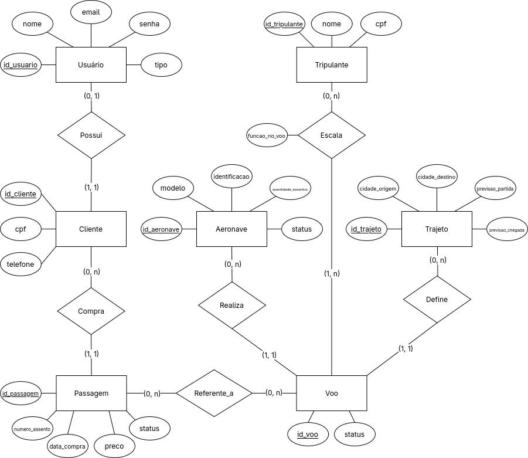
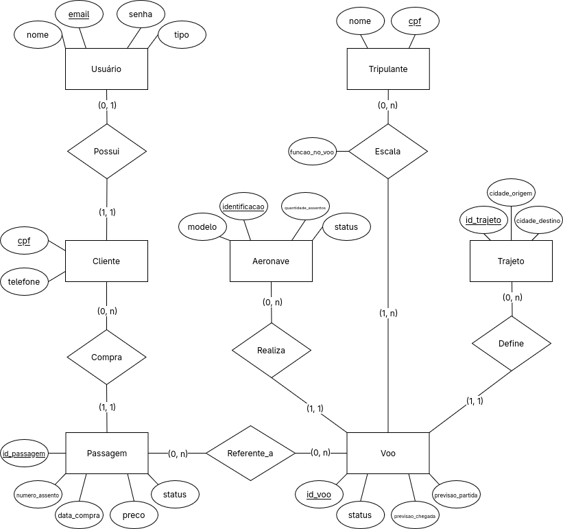

# Decolaê — Relatório de Evolução e Implementação do Banco de Dados

**Segunda entrega — TP Opção 1**

**Integrantes:** 
- Alan Vale

- Rafael Dayvid de Melo Freitas

- Walter de Macedo Cardoso

- Cristopher Resende

- Erick Raniere de Fatima


Esse relatório apresenta a evolução da modelagem conceitual, a estrutura do banco de dados, o povoamento inicial e o protótipo da interface.

---

# Evolução da modelagem

## Modelagem inicial

Pra primeira entrega do trabalho fizemos um levantamento dos requisitos do sistema, um modelo entidade-relacionamento e o mapeamento para o modelo relacional.



## Discussão entre os grupos

Durante as discussões sobre o trabalho foram levantados dois pontos:

1. Cardinalidades incorreta

A cardinalidade do relacionamento entre passagens e voos indicava que uma passagem podia ser referente a mais de um voo, o que não foi intencional e foi corrigido.

2. Falta de representação de responsabilidades

Foi sugerido que criasse especializações do tipo entidade "Usuário" para representar os diferentes tipos de usuário dentro do sistema, e então com essas especializações criasse relações como por exemplo: "administrador -> cria -> voo", "gerente -> cadastra -> trajeto".
Escolhemos não aderir a essa sugestão pois achamos que isso não precisava ser representado nesse diagrama pois parece mais ser parte da implementação, e não tanto do domínio de dados.  

Por fora das sugestões, removemos alguns IDs que estavam servindo de chave onde outros atributos poderiam ser a chave, por exemplo, o cliente possuía `cliente_id`, enquanto o `cpf` já bastava como chave primária.  
Também foi notado que a modelagem permitia o reaproveitamento de trajetos, porém as datas de partida e chegada do voo ficavam no próprio trajeto, dificultando o reuso. Foi ajustado pra que essas datas pertençam ao voo.

Após as revisões, o diagrama entidade-relacionamento foi atualizado incorporando os ajustes considerados adequados pelo grupo.



---

# Implementação do banco de dados

O banco de dados foi implementado utilizando **PostgreSQL**.

A implementação usa definição de tipos, chaves primárias, chaves estrangeiras, restrições de integridade e *triggers* pra garantir determinadas regras de negócio.

## Tabelas

O banco de dados contém oito tabelas principais.

| Tabela | Finalidade |
|---|---|
| `cliente` | Armazena os dados de identificação e contato dos clientes. |
| `usuario` | Armazena as credenciais, os nomes e os tipos de usuário. |
| `trajeto` | Representa as ligações entre cidades de origem e destino. |
| `aeronave` | Registra os modelos, as identificações, as capacidades e os status das aeronaves. |
| `tripulante` | Armazena os dados dos profissionais da tripulação. |
| `voo` | Registra os voos, seus horários, status, trajetos e aeronaves. |
| `passagem` | Representa as passagens emitidas, seus assentos, preços, clientes e voos. |
| `tripulacao_voo` | Associa os tripulantes aos voos e registra suas funções em cada operação. |

A separação entre usuário e cliente permite distinguir as informações de autenticação das informações relacionadas à identificação do cliente.  
Um usuário do tipo cliente deve estar associado a um registro em `cliente`.

A tabela `tripulacao_voo` representa o relacionamento `n:m` entre voos e tripulantes, armazenando a função do tripulante no voo.

## Chaves e integridade referencial

- A identificação da aeronave é única.
- O CPF identifica um cliente e um tripulante.
- O e-mail identifica um usuário.
- Cada voo possui um número único.
- Cada passagem possui um número de bilhete único.
- Cada passagem está associada a um voo e a um cliente existentes.
- Cada voo está associado a um trajeto e a uma aeronave existentes.
- Cada registro de tripulação está associado a um voo e a um tripulante existentes.
- Um mesmo tripulante não pode aparecer duas vezes na tabela associativa para o mesmo voo.

O identificador de trajeto é gerado automaticamente pelo PostgreSQL por meio de uma coluna `IDENTITY`.

## Regras de negócio implementadas

Parte das regras do sistema foi implementada diretamente no PostgreSQL por meio de funções e triggers. Essa abordagem permite centralizar determinadas validações no banco, evitando que elas dependam exclusivamente do comportamento da interface.
Talvez isso não seja o ideal para essas situações por questões de otimização, mas escolhemos implementar pra dar um foco maior no banco de dados, por ser o assunto da disciplina.

Embora parte das validações já esteja implementada, algumas regras previstas no levantamento de requisitos ainda precisam de mecanismos específicos.

| Regra | Situação |
|---|---|
| Impedir a emissão de passagens acima da capacidade | Possui validação por trigger. |
| Evitar a ocupação duplicada de assentos | Possui validação e restrição de unicidade; o tratamento de assentos liberados por cancelamento precisa ser ajustado. |
| Impedir emissão em estados inadequados do voo | Possui validação por trigger. |
| Impedir associação de voos a aeronaves em manutenção ou inativas | Possui validação por trigger. |
| Exigir tripulação mínima ao programar um voo | Possui validação por trigger na mudança de status. |
| Impedir sobreposição de horários para a mesma aeronave | Pendente. |
| Impedir escalas incompatíveis para um tripulante | Pendente. |
| Garantir o descanso mínimo de 36 horas após o limite de trabalho previsto | Pendente. |
| Impedir a compra de passagens para voos com horários incompatíveis para o cliente | Pendente. |
| Garantir a consistência das compras em transações concorrentes | Necessita de aprimoramento. |

A identificação dessas pendências orienta os próximos passos de desenvolvimento. Em particular, as validações de concorrência devem considerar que operações simultâneas podem consultar o mesmo estado do banco antes de efetuar alterações.

# Povoamento do banco de dados

## Estratégia de povoamento

Elaboramos um script SQL de povoamento inicial (`seed.sql`) com dados fictícios para validar os fluxos da aplicação.

 O script insere a seguinte quantidade de registros:

| Tabela | Registros planejados |
|---|---:|
| `CLIENTE` | 4 |
| `USUARIO` | 6 |
| `TRAJETO` | 4 |
| `AERONAVE` | 4 |
| `TRIPULANTE` | 8 |
| `VOO` | 4 |
| `TRIPULACAO_VOO` | 12 |
| `PASSAGEM` | 6 |

Cadastramos cenários com aeronaves ativas e em manutenção, além de voos nos status `PROGRAMADO` e `PLANEJAMENTO` para testar os bloqueios de emissão.

---

## 6.3. Consultas para demonstração

Abaixo estão as consultas SQL utilizadas para validar o retorno dos dados no backend:

### 6.3.1. Listagem de voos com trajeto e aeronave

```sql
SET search_path TO decolae;

SELECT
    V.numero_voo,
    T.cidade_origem,
    T.cidade_destino,
    V.previsao_partida,
    V.previsao_chegada,
    A.modelo,
    A.quantidade_assentos,
    V.status
FROM VOO V
JOIN TRAJETO T ON T.id_trajeto = V.id_trajeto
JOIN AERONAVE A ON A.identificacao = V.id_aeronave
ORDER BY V.previsao_partida;
```

Recupera os detalhes operacionais de cada voo cadastrado.

### 6.3.2. Consulta de assentos disponíveis

```sql
SELECT
    V.numero_voo,
    A.quantidade_assentos,
    COUNT(P.numero_bilhete) FILTER (
        WHERE P.status = 'EMITIDA'
    ) AS passagens_emitidas,
    A.quantidade_assentos
        - COUNT(P.numero_bilhete) FILTER (
            WHERE P.status = 'EMITIDA'
        ) AS assentos_disponiveis
FROM VOO V
JOIN AERONAVE A ON A.identificacao = V.id_aeronave
LEFT JOIN PASSAGEM P ON P.numero_voo = V.numero_voo
GROUP BY V.numero_voo, A.quantidade_assentos
ORDER BY V.numero_voo;
```

Calcula os assentos livres subtraindo as passagens emitidas da capacidade da aeronave.

### 6.3.3. Consulta de tripulantes escalados

```sql
SELECT
    TV.numero_voo,
    T.nome,
    TV.funcao_no_voo
FROM TRIPULACAO_VOO TV
JOIN TRIPULANTE T ON T.cpf = TV.cpf_tripulante
ORDER BY TV.numero_voo, TV.funcao_no_voo;
```

Exibe a equipe alocada para cada voo e a respectiva função a bordo.

### 6.3.4. Consulta de passagens por cliente

```sql
SELECT
    P.numero_bilhete,
    P.numero_assento,
    P.data_compra,
    P.preco,
    P.status,
    P.numero_voo,
    U.nome AS nome_cliente
FROM PASSAGEM P
JOIN CLIENTE C ON C.cpf = P.cpf_cliente
JOIN USUARIO U ON U.cpf_cliente = C.cpf
ORDER BY U.nome, P.data_compra;
```

Lista o histórico de compras de cada cliente no sistema.

**Observação:** os resultados dessas consultas devem ser inseridos no relatório após a execução no banco. As consultas apresentadas são exemplos de demonstração e não constituem, por si só, evidência de que todos os testes foram executados.

# Protótipo da interface

Desenvolvemos o protótipo da aplicação organizado pelos três perfis de acesso. O sistema redireciona o utilizador para o painel correspondente conforme a autenticação.

## Tela de login

Permite o acesso com seleção rápida de perfil para testes.


## Painel do cliente

Permite pesquisar voos por origem, destino e data, além de visualizar o histórico de reservas do passageiro.


## Painel do administrador

Apresenta o painel com indicadores gerais da operação e modal para inclusão de novos voos.


## Painel do gerente

Contém as abas para gestão de rotas/trajetos, frota de aeronaves e escalas da tripulação.


---

# 8. Estado atual e próximos passos

Atualmente, a estrutura do banco de dados, o script de povoamento e as rotas da API estão integrados com o frontend (com exceção do fluxo final de reserva de passagens, que ainda simula a resposta na interface).

Para a entrega final, vamos focar nos seguintes pontos:

- Finalizar os triggers de verificação de choque de horários (aeronaves e tripulantes).
- Implementar as regras de descanso mínimo para a tripulação.
- Ajustar o tratamento de concorrência na compra simultânea de assentos.
- Concluir a integração total do fluxo de reservas com o banco de dados.
- Realizar os testes de integração e validação de permissões por perfil.

Essas atividades buscam garantir que a versão final seja capaz de atender aos requisitos funcionais e às restrições operacionais do sistema.

Links de acesso para o projeto:
---

> **Acesso ao Protótipo e Código-Fonte:**
> - 🔗 **Repositório do projeto:** [github.com/alaanvv/Decolae](https://github.com/alaanvv/Decolae)
> - 🖥️ **Interface do protótipo (HTML):** [app/index.html](https://github.com/alaanvv/Decolae/blob/master/app/index.html) *(para testar localmente, basta clonar o repositório e abrir o arquivo `index.html` no navegador)*

---
